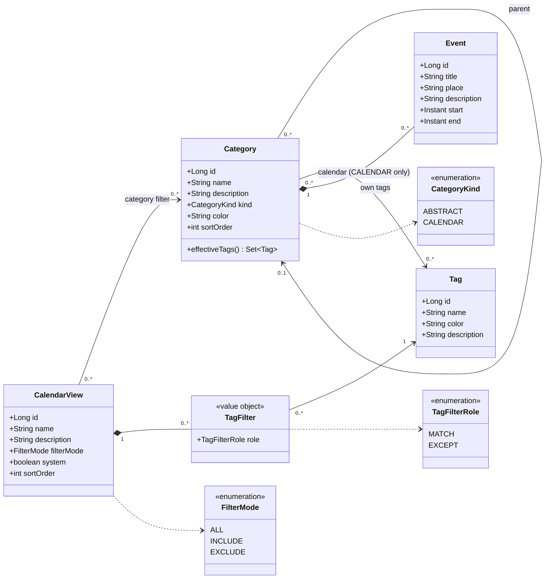
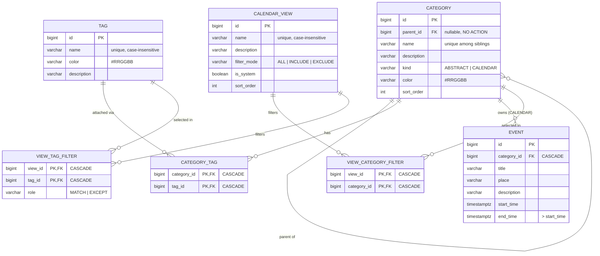

# calendarManager — Data Model

This document describes the domain model (UML), the database design (Entity-Relationship model) and the
PostgreSQL schema of calendarManager. The schema is the Flyway migration
[`V1__schema.sql`](../backend/src/main/resources/db/migration/V1__schema.sql).

## 1. Domain concepts

| Concept | Meaning |
|---|---|
| **Category** | A node of a hierarchical tree. It has a name, an optional parent and a set of tags. |
| **ABSTRACT category** | A container ("group") for sub-categories. It has tags but **no calendar**, so it cannot hold events. |
| **CALENDAR category** | A leaf that **owns a calendar**, i.e. events. It cannot have sub-categories. It may sit at root level. |
| **Tag** (label) | An object of its own, attached to categories. A category **inherits all tags of its ancestors**. |
| **Event** | An event or appointment of a CALENDAR category: title, place, short description, start and end. Events of different calendars may overlap freely. |
| **Calendar view** | A saved filter (ALL / INCLUDE / EXCLUDE) over categories and tags. It decides which calendars appear side by side. |

## 2. UML class diagram



All entities also carry `version` (optimistic locking), `createdAt` and `updatedAt`.

## 3. Entity-Relationship model



## 4. PostgreSQL schema (summary)

These columns are common to all main tables:

- `id BIGINT GENERATED ALWAYS AS IDENTITY PRIMARY KEY`
- `version BIGINT`
- `created_at` and `updated_at TIMESTAMPTZ`

| Table | Constraints / indexes |
|---|---|
| `tag` | unique index on `lower(name)`; hex-color CHECK; non-blank CHECK |
| `category` | `kind` CHECK; `UNIQUE NULLS NOT DISTINCT (parent_id, name)`; `CHECK (parent_id <> id)`; index on `parent_id` |
| `category_tag` | PK (category_id, tag_id); both FKs `ON DELETE CASCADE`; index on `tag_id` |
| `event` | `CHECK (end_time > start_time)`; indexes `(category_id, start_time, end_time)` and `(start_time, end_time)` |
| `calendar_view` | `filter_mode` CHECK; unique index on `lower(name)` |
| `view_category_filter` | PK (view_id, category_id); both FKs CASCADE |
| `view_tag_filter` | PK (view_id, tag_id); `role` CHECK; both FKs CASCADE |

`V2__system_view.sql` seeds the system view **"All calendars"** (`ALL`, `is_system = true`).

### Where rules are enforced

- **Database** (structural): FKs, CHECKs, UNIQUE constraints and time-range validity.
- **Service layer** (domain rules, with clear HTTP 409/422 problem details):
  - Only ABSTRACT categories can be parents.
  - Only CALENDAR categories can own events.
  - No cycles when re-parenting.
  - `ABSTRACT → CALENDAR` only without children; `CALENDAR → ABSTRACT` only without events.
  - Deleting a category with sub-categories or events requires `cascade=true`.
  - The system view cannot be deleted and its filter cannot be changed.

## 5. Tag inheritance

```
effectiveTags(c) = ownTags(c) ∪ effectiveTags(parent(c))
```

Inherited tags are **computed, not stored**. The backend loads the whole tree in one query into an in-memory
snapshot ([`CategoryTree`](../backend/src/main/java/com/calendarmanager/category/CategoryTree.java)). For every
inherited tag the API also reports the nearest ancestor it comes from.

## 6. View filter semantics

Two terms are used below:

- **In subtree** means the calendar itself or one of its ancestors is selected. Selecting a group therefore
  selects all of its sub-categories.
- **Has tag** refers to the effective (inherited) tags.

| Mode | A calendar is shown when … |
|---|---|
| **ALL** | always (default view) |
| **INCLUDE** (positive) | (no categories selected **or** in a selected subtree) **and** (no tags selected **or** has any MATCH tag). An INCLUDE view must select at least one category or tag. |
| **EXCLUDE** (negative) | **not** [(in an excluded subtree **or** has an excluded MATCH tag) **and not** has an EXCEPT tag] |

Visible calendars are ordered depth-first through the tree (sibling order: `sort_order`, then name). That
order is the column order of the day view, and the ancestor path of each calendar forms the hierarchical
column header. The implementation is
[`ViewFilterEvaluator`](../backend/src/main/java/com/calendarmanager/view/ViewFilterEvaluator.java), and its
unit tests double as executable examples.

## 7. Time handling

- Event times are stored as `TIMESTAMPTZ` (UTC) and exchanged as ISO-8601 with offset.
- The browser computes the bounds of a local day (DST-safe) and requests events that overlap `[from, to)`.
  An event ending exactly at `from` is excluded.
- The day grid shows **6:00–0:00 in 30-minute slots**:
  - Events before 6:00 are collapsed into a "before 6:00" chip.
  - Events crossing the window edges are clipped and marked with a dashed edge.
