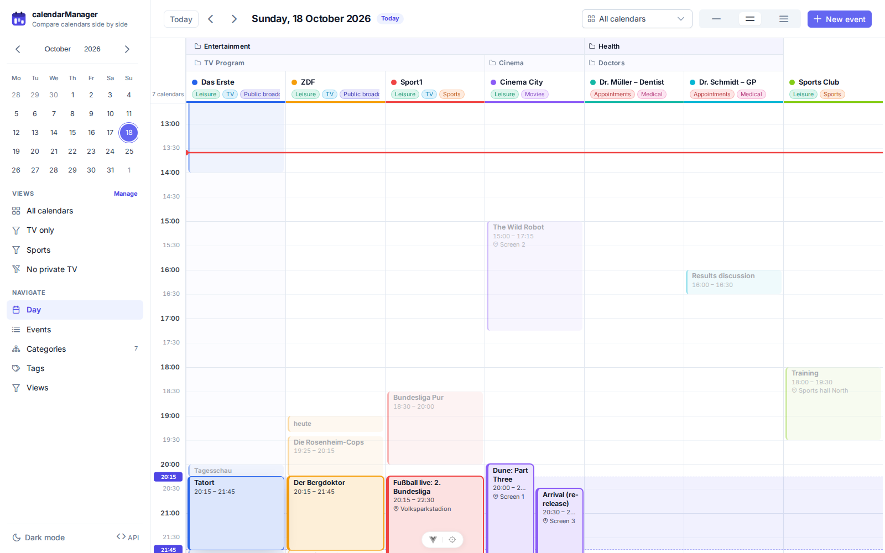
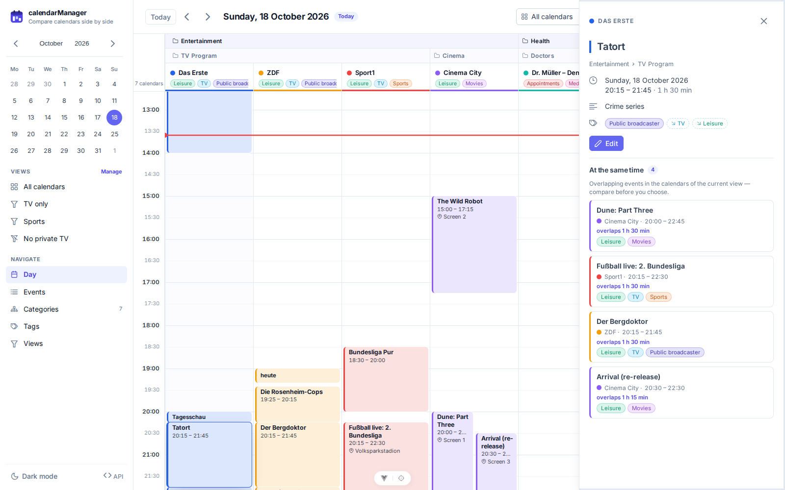
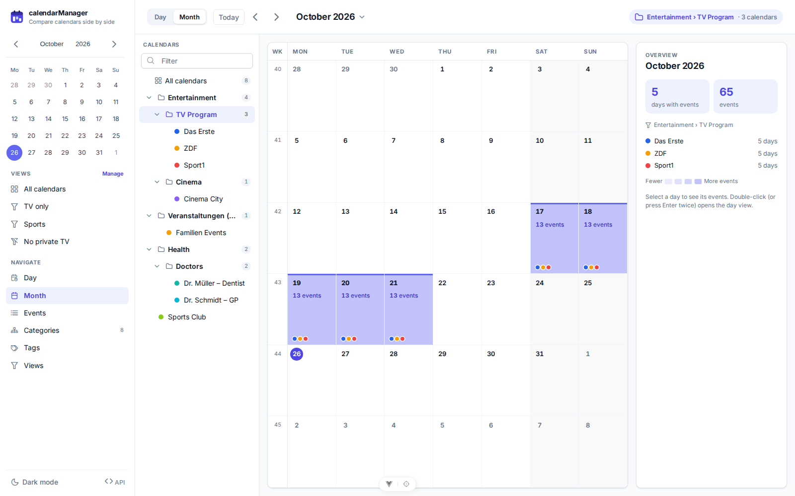
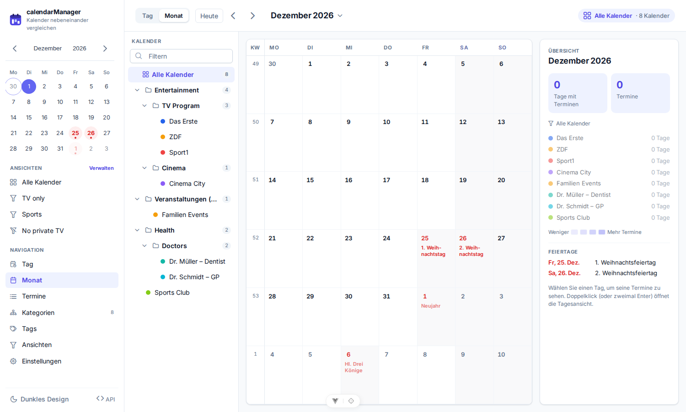
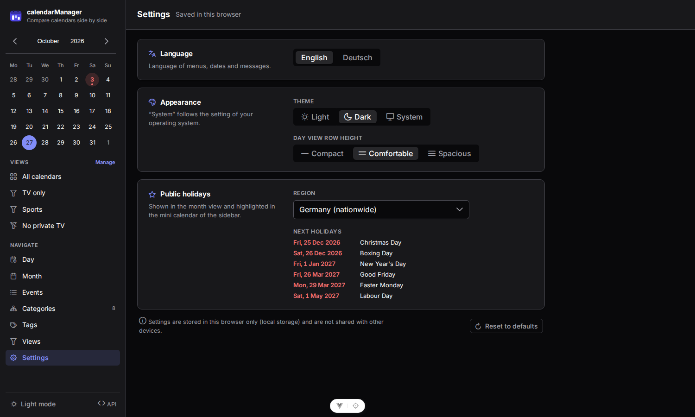
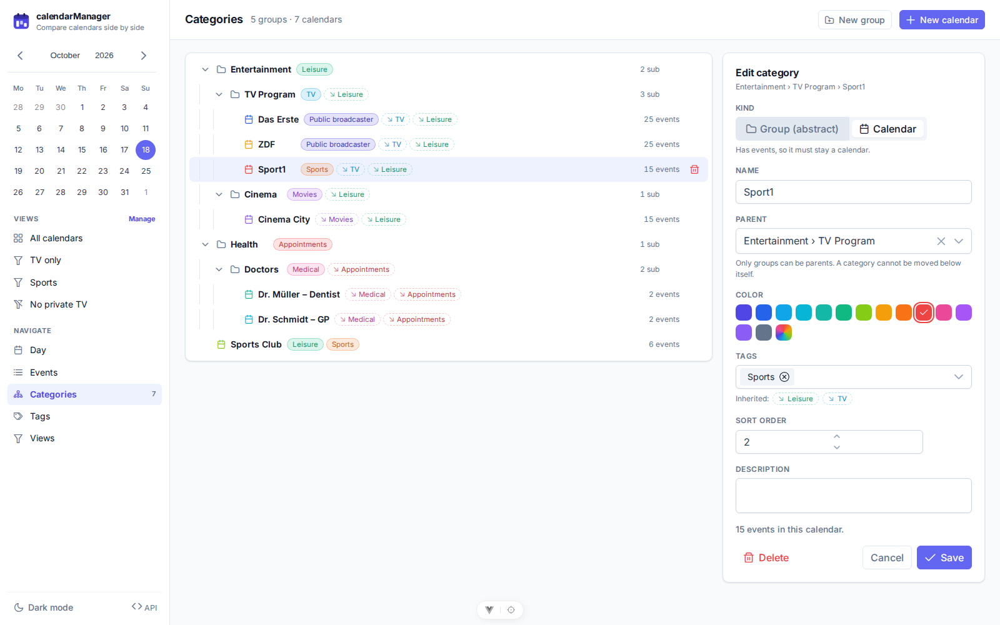
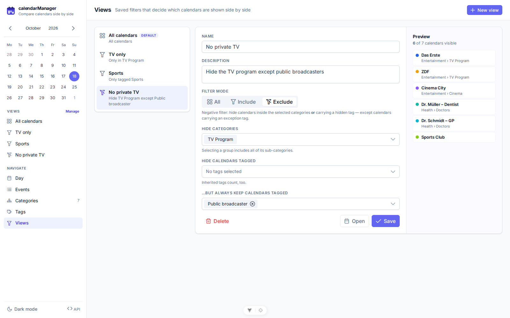
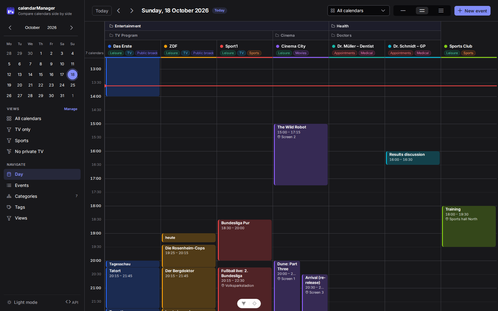

# calendarManager — UI/UX Design

## Design goal

People use calendarManager to **decide between events that happen at the same time**: a TV show, a film or a
doctor's appointment. So the UI is built around one question, *"what else is on at this time?"*:

- Every calendar of a view sits **side by side on one shared time axis**.
- The **category hierarchy** forms the column headers.
- Comparing simultaneous events takes **one hover or one click**.



## Design system

| Aspect | Choice |
|---|---|
| Component library | PrimeVue 4 (MIT), Aura preset with indigo primary and slate surfaces ([`theme.ts`](../frontend/src/theme.ts)) |
| Typeface | Inter Variable (self-hosted), tabular numerals for times |
| Spacing / radius | 4/8 px grid; 10 px card radius, 6 px controls and event cards |
| Color | One accent (indigo). Calendars get colors from a 14-color palette that reads well in light and dark mode. Event cards use a 16 % tint (26 % in dark mode) with a solid 3 px left border in the calendar color. |
| Tags | Pill chips in the tag color. **Own tags are solid; inherited tags are dashed** with a ↘ marker. |
| Themes | Light, dark, or follow the system setting (sidebar toggle, remembered). |
| Feedback | Toasts for success and errors (backend ProblemDetail messages); confirm dialogs that state what will be deleted. |

## Layout

```
┌──────────────┬─────────────────────────────────────────────────────────────────────┐
│ ▣ calendar-  │ [Today] ‹ ›  Sunday, 18 October 2026 (Today)   [View ▾] [≡ density] [+ New event] │
│   Manager    ├──────┬────────────────────────────────────────────┬──────────────┬──────────┤
│              │      │ 🗀 Entertainment                            │ 🗀 Health     │          │
│  mini month  │      ├──────────────────────────────┬─────────────┼──────────────┤  Sports  │
│  calendar    │      │ 🗀 TV Program                 │ 🗀 Cinema    │ 🗀 Doctors    │  Club    │
│              │      ├─────────┬─────────┬──────────┼─────────────┼───────┬──────┤          │
│ VIEWS        │      │●Das Erste│● ZDF   │● Sport1  │● Cinema City│●Müller│●Schm.│          │
│  All         │      │ tags…   │ tags…   │ tags…    │ tags…       │ tags… │ tags…│ tags…    │
│  TV only     ├──────┼─────────┴─────────┴──────────┴─────────────┴───────┴──────┴──────────┤
│  …           │ 6:00 │                                                                      │
│ NAVIGATE     │ 6:30 │      event cards; overlapping events of one calendar side by side    │
│  Day/Events/ │  …   │░░░░░░░░░ hover band: same time slot across all calendars ░░░░░░░░░░░░│
│  Categories/ │ 0:00 │                                                                      │
│  Tags/Views  │      │                                                                      │
└──────────────┴──────┴──────────────────────────────────────────────────────────────────────┘
```

- **Sidebar** (becomes a drawer below 900 px): brand, inline month picker, list of saved views, navigation,
  theme toggle and a link to the API docs (Swagger UI).
- **Top bar of the day view**: Today, previous/next day, date title, view selector, row density
  (compact / comfortable / spacious) and *New event*.

## Day view (core screen)

Layout:

- **Time axis**: 6:00 to 0:00 in 30-minute steps, printed at the left edge. Full hours are bold; half hours
  are lighter and use fainter grid lines.
- **Hierarchical header**: every ancestor category is a header cell spanning the columns of its visible
  descendants. Calendars higher in the tree span down to the calendar row. Group labels stay visible while
  scrolling horizontally. Each calendar cell shows its color, name and effective tags, with the full path as
  a tooltip.
- **Sticky header and gutter**: the header stays on top while scrolling vertically. The time gutter stays on
  the left while scrolling horizontally through many calendars.
- **Column width**: columns are at least 168 px wide and share any remaining width.
- **Overlaps within one calendar**: events are laid out in lanes, Google-Calendar style. A card shows title,
  time and place depending on its height.

Events outside the visible window:

- Events before 6:00 collapse into a "↑ N before 6:00" chip.
- Events reaching past the window edges are clipped with a dashed edge.

Comparison features:

- **Hover comparison**: hovering or focusing an event draws a band across all calendars for its time slot,
  with start and end shown in the gutter. Concurrent events are outlined; all others are dimmed.
- **Details drawer**: clicking an event opens a side drawer. It shows the breadcrumb path, time and
  duration, place, description, and own and inherited tags. It also lists **"At the same time"**: every
  overlapping event in the view's other calendars, with its overlap duration. Clicking one switches to it.

Other behaviour:

- **Now line**: a red line marks the current time on today's date. The view scrolls to it.
- **Create**: click an empty slot (1 h) or drag across slots (30-minute snapping). The event dialog opens
  prefilled with that calendar and time range.
- **Keyboard**: `T` today, `←` / `→` change day, `N` new event.
- **Empty states**: a view that hides every calendar offers "Edit view". An empty database offers
  "Create calendar".



## Month view



The month view answers *"on which days is anything happening in these calendars?"*

The **calendar list on the left** is a secondary side navigation:

- It offers *All calendars*, every group and every calendar of the tree.
- It has indent levels, collapsible groups, calendar counts per group and a filter field.
- Selecting a **group** includes all calendars below it. Selecting a **calendar** shows only that calendar.
- On phones the list becomes a dropdown in the header.

The **month grid**:

- Weeks start on Monday, with ISO week numbers in a narrow column on the left.
- It always shows 6 weeks, so its height never jumps between months.
- Days of the previous and next month are muted but still highlighted.
- **Every day with at least one event is highlighted**:
  - an accent bar along the top edge
  - an indigo tint whose intensity grows with the number of events (1 / 2–3 / 4–7 / 8+)
  - the event count
  - one colour dot per calendar that has events that day
  - Multi-day events count on every day they touch, in the browser's time zone.
- Today has a filled date marker.

Navigation:

- Toolbar: `Today`, `‹ ›`, and a click on the month title opens a month/year picker. The **Day | Month**
  switch toggles between the day and month layouts.
- The URL holds the state (`/month/2026-10?category=2&day=2026-10-19`), so back/forward and bookmarks
  work. The last selected calendar or group is remembered.
- Keyboard: `←` / `→` (or PageUp/PageDown) change the month, `T` jumps to the current month and `Esc`
  clears the day selection.
- Inside the grid the arrow keys move the selected day. They cross month boundaries, and the grid follows.
  Enter on the selected day, or a double-click, opens it in the day view.

The **right panel**:

- With no day selected, it shows a month overview: days with events, total events, and per calendar the
  number of active days. This also serves as the colour legend.
- With a day selected, it lists that day's events. Clicking one opens the details drawer. The panel also
  offers *Day view* and *New event* (prefilled with the day and the first calendar of the selection).

## Languages, holidays and settings



The **Settings** page (sidebar → Settings) groups everything that is stored in the browser (`localStorage`):

- **Language**: English (default) or Deutsch.
  - The switch applies immediately, without reloading the page.
  - Menus, dates (*Monday, 19 October 2026* / *Montag, 19. Oktober 2026*), durations and plurals follow it, as
    do the PrimeVue components (date pickers, table texts).
  - The API client sends `Accept-Language`, so the backend's error messages arrive in the same language.
  - Data such as calendar or tag names is never translated. The only exception is the built-in view
    *All calendars*, as long as it keeps its original name.
- **Appearance**: theme (light / dark / system) and the row height of the day view.
- **Public holidays**:
  - Germany nationwide (default), one of the 16 federal states, or off.
  - A preview lists the next holidays of the chosen region.
  - Holidays are computed in the browser from fixed dates and Easter, including the year in which each rule
    applies (e.g. Reformation Day). Holidays that apply only in some municipalities are not included.

Where holidays appear:

- **Month grid**:
  - a red date and a short name, e.g. *Unity Day* or *Himmelfahrt*, with the full name as tooltip and in the
    cell's `aria-label`
  - a neutral background like weekends, so the event highlighting stays unambiguous
- **Month panel**: a holiday chip for the selected day, and the list of the month's holidays in the overview.
- **Mini calendar** (top left of the sidebar): a red date on a soft red background, with a dot and the name as
  tooltip.
- **Day view**: a badge with the holiday's name next to the date title.



## Management screens (CRUD)

- **Events**:
  - A paged, sortable table filtered by date range, calendars and full-text search.
  - Clicking a row opens the details drawer. The edit and delete actions are always visible.
  - The event form has title, calendar (grouped by category path), start and end (24 h, 5-minute steps,
    keeps the duration when the start moves), place, and a description with a character counter.
- **Categories**:
  - A collapsible tree with indent guides, kind icons, own and inherited tag chips, and event or child counts.
    Hover actions: add sub-category, delete.
  - The side panel edits the category:
    - **Kind**: locked, with an explanation, when the change would violate the rules.
    - **Parent**: only groups outside the category's own subtree can be chosen.
    - **Color** swatches, **own tags**, and a live preview of the tags it would inherit from the chosen parent.
  - Delete shows what is affected, e.g. *"deletes 3 sub-categories and 42 events"*.
- **Tags**: a table with chip preview, description and usage count; a create/edit dialog with a color picker.
- **Views**:
  - A list of views with a plain-language summary (e.g. *"Hide TV Program except Public broadcaster"*).
  - An editor with the filter mode switch (All / Include / Exclude) and a category-subtree picker. Tag
    selectors offer "any of" (Include), "hide" and "except" (Exclude).
  - A **live preview** of which calendars the filter shows.




## Accessibility and responsiveness

- All interactive elements are buttons or inputs and can be reached with the keyboard. The tree uses
  `role=tree` and `role=treeitem`. Event cards have descriptive `aria-label`s.
- Color is never the only signal: calendar names, kind icons and dashed borders (inherited tags, clipped
  events) carry the same meaning.
- Below 900 px the sidebar becomes a drawer and toolbars wrap. The day grid scrolls horizontally with a
  sticky time gutter.


